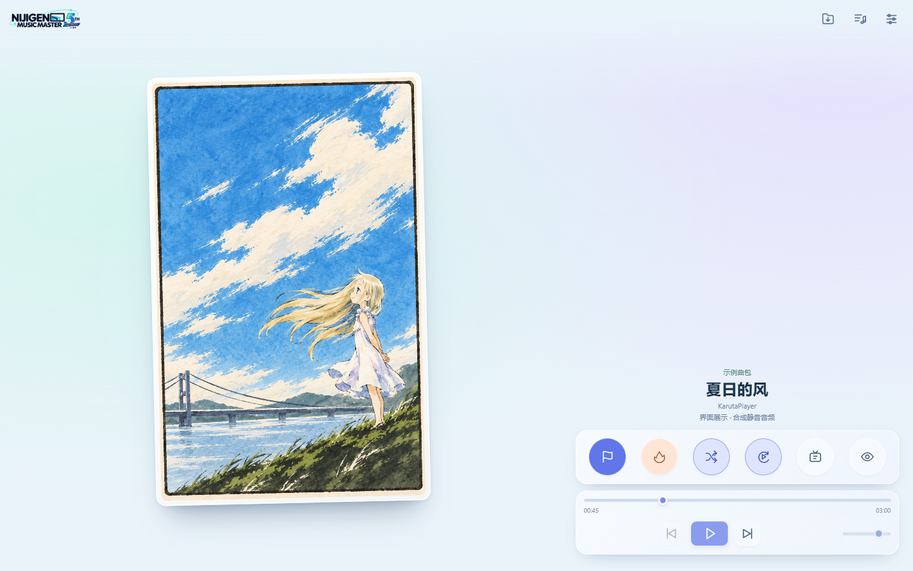

# KarutaPlayer · 歌牌播放器

离线运行的音乐歌牌播放器，支持普通听歌、片段读牌和自我练习。使用原生 HTML、CSS、JavaScript，无第三方运行依赖；另提供 Android WebView 封装。



示意图使用用户提供的图片和合成静音音频，不使用 CoreSet / Dark 曲包封面。

## 快速开始

下载或克隆本仓库后，用现代 Chrome / Edge 打开 `index.html`。也可安装 Python 3，在仓库根目录运行：

```sh
python -m http.server 8765 --bind 127.0.0.1
```

浏览器访问 <http://127.0.0.1:8765>。运行网页不需要 Node.js、构建步骤或账号。歌包请自行准备，仓库不附带商业歌曲曲库。

## 功能

- 导入一个或多个 ZIP 歌包，支持嵌套目录、UTF-8 / GB18030 CSV、按需解压音频和图片。
- 普通模式播放整首歌曲，支持暂停、切歌、进度和音量控制。
- 游戏模式支持随机 / 顺序牌序、片段长度、起点、牌间间隔、全自动、循环和练习揭晓。
- TVSize 将随机起点限制在前 80 秒，不改变片段长度。
- 独立热场音乐、真实音频频谱、响应式横竖屏界面、减少动态效果适配。
- 曲目搜索、歌包及单曲勾选、对局记录 JSON 导出。
- Android 支持记忆 ZIP 文件授权、媒体通知与后台播放，实际表现仍需真机验证。

使用方法和曲包格式见 [使用指南](docs/USAGE.md)。Android 构建见 [Android 说明](android/README.md)。

## 开发与验证

需要 Node.js 22+；默认检查不需要安装 npm 依赖：

```sh
npm run check
npm test
```

浏览器冒烟测试使用 Playwright，安装方式及历史测试的限制见 [贡献指南](CONTRIBUTING.md)。CI 配置在 Windows 和 Linux 上运行语法检查与 Node 测试；远端尚未运行。本次已执行的检查见 [验证记录](docs/VALIDATION.md)，不代表 Android 真机兼容性验证。

## 项目结构

```text
app.js / core.js / zip.js  界面与播放状态、数据与算法、ZIP 读取
index.html / style.css    网页入口与响应式样式
assets/                   内置视觉素材与热场音频
android/                  原生 Java 封装及 Windows 离线构建脚本
windows/                  开发中的 Windows WebView2 封装（尚未验证）
tests/                    Node 测试、合成曲包及浏览器测试
docs/                     使用指南、截图和历史验证记录
.github/                  CI、Issue 和 PR 模板
```

构建产物和签名仅保存在本地；APK 应通过 GitHub Releases 分发。上传范围和发布步骤见 [发布说明](docs/RELEASING.md)。

## 状态与限制

当前 Android 源码版本为 `1.0.0-preview.7`，包名为 `com.stelledge.nijigenmusicmaster`，最低 Android 8.0。网页与 Android 源码共享同一套播放器文件。已有 APK 不自动随源码变化更新。

音频格式取决于浏览器和系统的解码能力。移动浏览器可能限制自动播放，锁屏或切后台可能暂停；Android 后台服务仍需实机验证。ZIP 不支持加密、分卷或 ZIP64，单文件解压上限 512 MiB。

## 许可与素材

项目代码使用 [Apache License 2.0](LICENSE)。`assets/` 下全部资产的版权归星刃（StellEdge）所有，采用 [CC BY-NC-SA 4.0](assets/LICENSE.md)，允许署名、非商业性使用及相同方式共享的改编。素材与第三方内容的权利范围见 [素材说明](ASSETS.md)。

本项目参考原 Nijigen Music Master Unity 工程的歌包格式重写，不包含原 Unity 工程、NAudio 或个人 MusicData 曲库。
